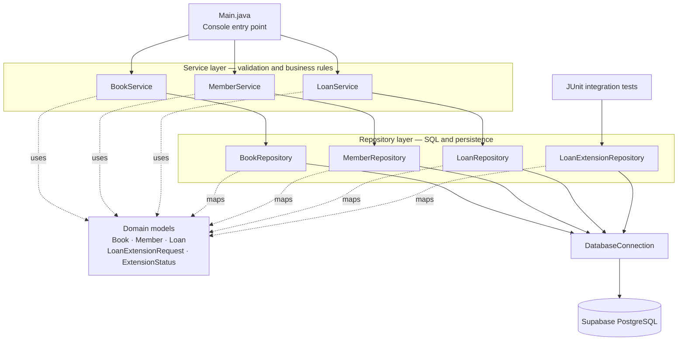
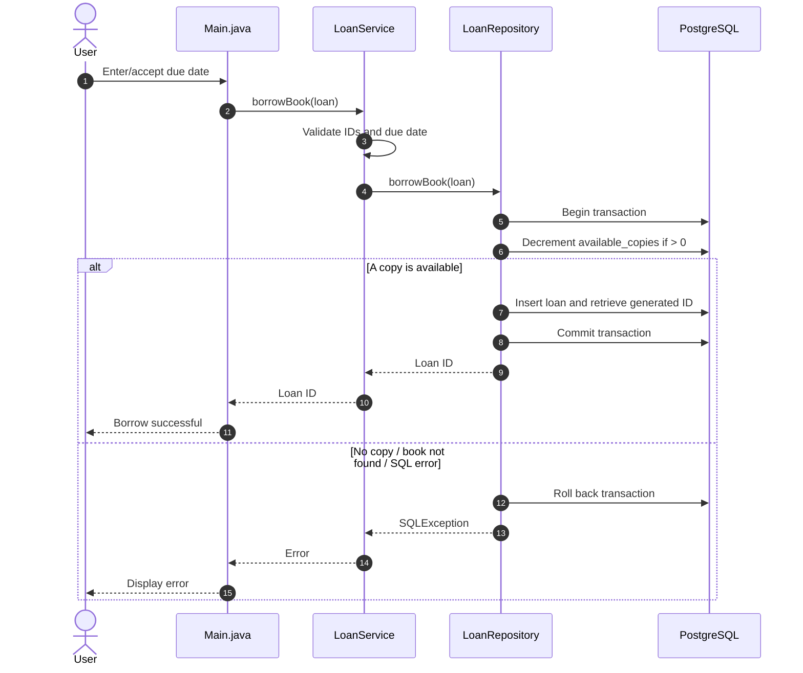
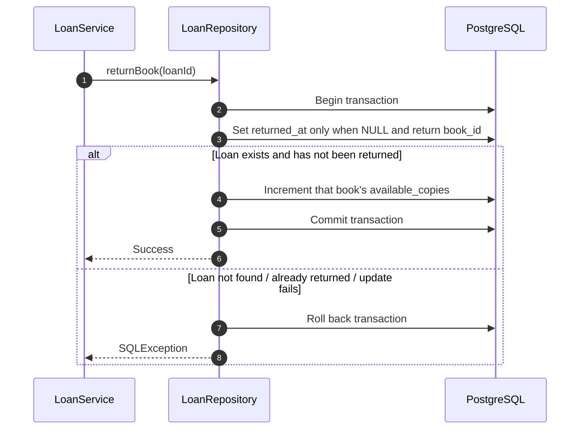
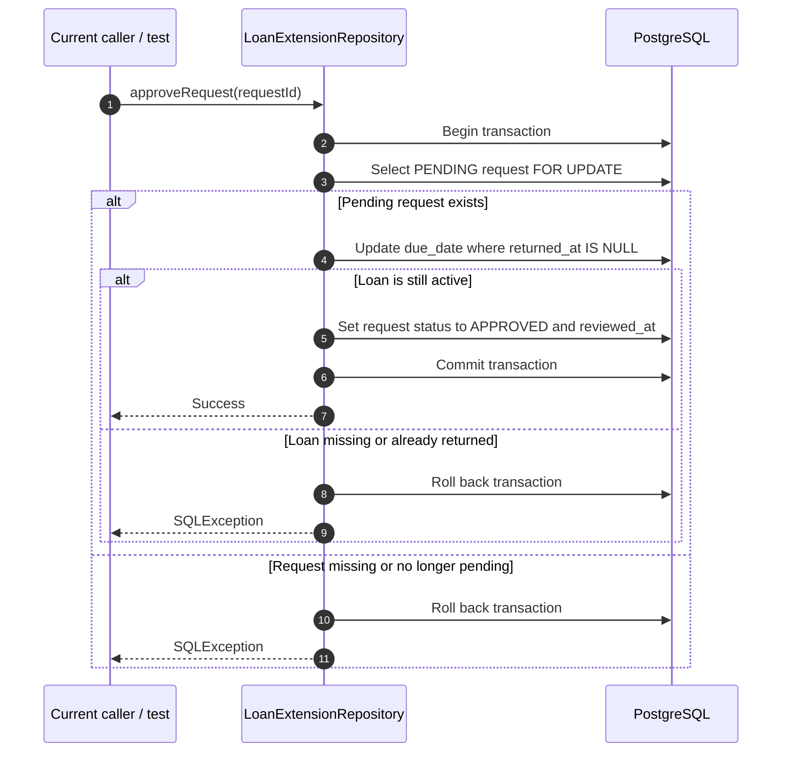

# ShelfWise

**ShelfWise** is a Java-based library management backend project built to practise layered application design, JDBC, PostgreSQL, transaction handling, and integration testing.

The project is actively being developed. It currently includes a small console entry point and backend operations for books, members, borrowing/returns, and loan-extension requests. It is **not yet a REST API or a finished production application**.

## Current features

- **Books:** add books, list books, update copy counts, and delete books, with service-layer input validation.
- **Members:** register members and list registered members, including basic name/email validation.
- **Borrowing:** validate loan IDs and due dates; the standard borrowing period is limited to 14 days.
- **Returning:** mark a loan as returned and restore the book's available-copy count in one database transaction.
- **Loan extensions:** create an extension request, list pending requests, and approve a pending request.
- **Transactional approval:** approval locks a pending request, updates the due date only if the loan has not been returned, marks the request as approved, and commits both changes together. If a database operation fails, the transaction is rolled back.
- **Integration tests:** exercise extension-request creation/retrieval and approval scenarios against PostgreSQL.

The extension status enum and schema also define `REJECTED` and `WITHDRAWN`; the corresponding repository workflows have not been implemented yet.

## Tech stack

- **Language:** Java (the Maven project currently targets Java 26)
- **Build:** Apache Maven
- **Database:** PostgreSQL hosted on Supabase
- **Database access:** JDBC with prepared statements and explicit transactions where needed
- **Testing:** JUnit 5 integration tests
- **IDE used during development:** Apache NetBeans

## Architecture

ShelfWise follows a simple layered structure. The console entry point calls service classes; services validate business input and delegate persistence work to repositories. Repositories use `DatabaseConnection` to access PostgreSQL.



> **Current extension workflow note:** extension request persistence is implemented in `LoanExtensionRepository`, and integration tests call it directly. A dedicated `LoanExtensionService` and an admin-facing workflow have not been added yet.

### Layer responsibilities

| Layer | Responsibility | Examples |
|---|---|---|
| Entry point | Interacts with the user and invokes application operations | `Main.java` |
| Service | Validates inputs and applies business rules before persistence | `BookService`, `MemberService`, `LoanService` |
| Repository | Runs SQL and maps database rows to Java objects | `BookRepository`, `MemberRepository`, `LoanRepository`, `LoanExtensionRepository` |
| Model | Represents domain data | `Book`, `Member`, `Loan`, `LoanExtensionRequest`, `ExtensionStatus` |
| Database | Stores records and enforces relational constraints | Supabase PostgreSQL |

## Workflow diagrams

### 1. Borrow a book

The default due date in the current console example is today plus 14 days. The user may enter a different date, but `LoanService` rejects dates in the past or beyond the standard 14-day period.



### 2. Return a book



### 3. Approve a loan-extension request



## Project structure

```text
ShelfWise/
├── pom.xml
├── .gitignore
├── shelfwise.properties            # Local database credentials; do not commit
└── src/
    ├── main/
    │   ├── java/com/sayan/shelfwise/
    │   │   ├── Main.java
    │   │   ├── database/
    │   │   │   ├── DatabaseConnection.java
    │   │   │   └── SchemaInitializer.java
    │   │   ├── model/
    │   │   │   ├── Book.java
    │   │   │   ├── Member.java
    │   │   │   ├── Loan.java
    │   │   │   ├── LoanExtensionRequest.java
    │   │   │   └── ExtensionStatus.java
    │   │   ├── repository/
    │   │   │   ├── BookRepository.java
    │   │   │   ├── MemberRepository.java
    │   │   │   ├── LoanRepository.java
    │   │   │   └── LoanExtensionRepository.java
    │   │   └── service/
    │   │       ├── BookService.java
    │   │       ├── MemberService.java
    │   │       └── LoanService.java
    │   ├── resources/
    │   │   ├── books.sql
    │   │   ├── members.sql
    │   │   ├── loans.sql
    │   │   └── loan_extension_requests.sql
    └── test/java/com/sayan/shelfwise/repository/
        ├── LoanExtensionRepositoryTest.java
        └── LoanExtensionApprovalTest.java
```

## Database schema

The SQL scripts are in `src/main/resources/` and depend on one another:

1. `books.sql` creates the `books` table and validates copy counts.
2. `members.sql` creates the `members` table; email addresses are unique.
3. `loans.sql` creates `loans`, which references `books` and `members`.
4. `loan_extension_requests.sql` creates the extension-status enum and `loan_extension_requests`, which references `loans`.

The extension-request table records the requested due date, request status, timestamps, and optional reason. A check constraint keeps status/timestamp combinations consistent, and a partial unique index prevents more than one pending request for the same loan.

**Schema setup note:** `SchemaInitializer.initialize()` currently loads `/loans.sql` only. For a fresh database, apply the four SQL scripts in the order above through the Supabase SQL Editor, skipping any tables that already exist. The scripts are not written as repeatable migrations, so do not blindly execute them multiple times.

## Getting started

### Prerequisites

- JDK 26, to match `maven.compiler.release` in `pom.xml`
- Maven (the Maven installation bundled with NetBeans is also suitable)
- A Supabase PostgreSQL project and its database credentials

### 1. Clone the repository

```bash
git clone https://github.com/Sayan1776/ShelfWise.git
cd ShelfWise
```

### 2. Configure database access

Create a file named `shelfwise.properties` in the project root, next to `pom.xml`:

```properties
db.url=jdbc:postgresql://YOUR_SUPABASE_HOST:5432/postgres?sslmode=require
db.user=YOUR_DATABASE_USER
db.password=YOUR_DATABASE_PASSWORD
```

Replace the placeholders with the appropriate JDBC connection details from your Supabase project. The JDBC URL and credentials must be valid for the connection method you choose.

`DatabaseConnection` reads the `db.url`, `db.user`, and `db.password` properties. The `.gitignore` already excludes `/shelfwise.properties`; **never commit this file, your database password, or other credentials**.

### 3. Prepare the database

Apply the SQL scripts as described in [Database schema](#database-schema), in dependency order. If you already have `books` and `members` tables in Supabase, do not recreate them; confirm that their columns match the scripts and the repository queries.

### 4. Build and run tests

Run all tests:

```bash
mvn clean test
```

Run only the loan-extension integration tests:

```bash
mvn -Dtest=LoanExtensionRepositoryTest,LoanExtensionApprovalTest test
```

These tests connect to the configured PostgreSQL database; they are not purely in-memory unit tests. Use a development/test database, not a database containing important production records.

**Test-data note:** the existing `LoanExtensionRepositoryTest` uses `loan_id = 7`, so a loan with that ID must exist and must satisfy the pending-request constraint for those tests. `LoanExtensionApprovalTest` creates and cleans up its own book/member/loan fixtures. The tests can be made more portable in a later pass by having all test classes create their own fixtures.

### 5. Run the current console example

Open the Maven project in NetBeans and choose **Run Project**. `Main.java` is still a development harness: the active example uses book ID `1` and member ID `1`, defaults to a due date 14 days from today, and accepts a replacement date in `YYYY-MM-DD` format. Make sure those IDs exist and the book has an available copy before trying the borrow flow.

## Test coverage

The current integration tests cover:

- Generating an ID when an extension request is created
- Retrieving pending extension requests
- Rejecting a second pending request for the same loan
- Approving a valid request and updating both the loan due date and request status
- Rejecting a duplicate approval
- Rejecting approval for a returned loan and verifying rollback
- Rejecting an approval attempt for a nonexistent request

## Current limitations and next steps

- `Main.java` is a temporary console test harness, not a complete interactive application.
- Loan-extension business validation has not yet been moved into a dedicated `LoanExtensionService`.
- Rejecting and withdrawing extension requests are represented in the schema but their workflows are not implemented.
- Admin authentication/authorization is not implemented.
- There is no REST API or web UI yet.
- Database schema management is currently based on SQL scripts rather than versioned migrations.

Possible next milestones are adding a `LoanExtensionService`, implementing reject/withdraw operations, expanding integration tests, making test fixtures independent of existing IDs, and then deciding whether to expose the backend through a REST API.
